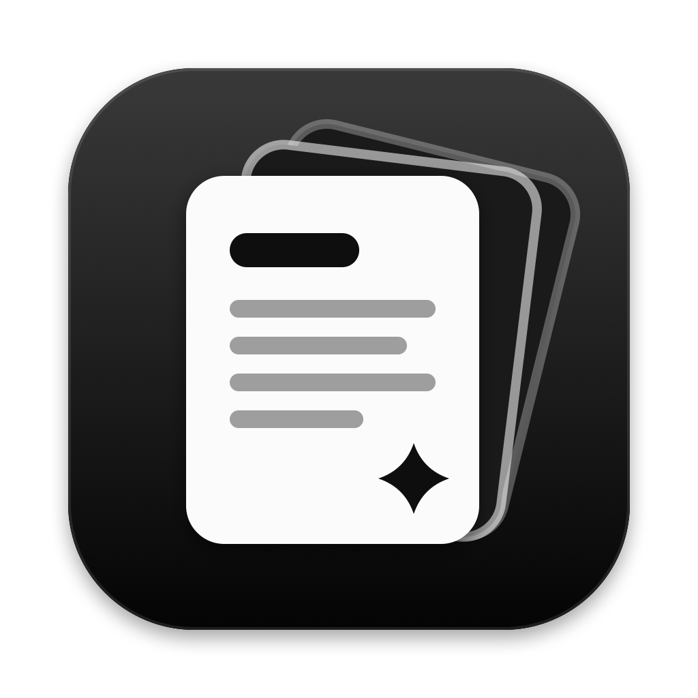

# Knack

Browse, edit, and share AI agent skills across your tools and projects — native macOS app written in Rust.

## Run

```sh
cargo run                  # run in debug mode
cargo test                 # run disk unit tests + headless UI integration tests
./bundle.sh --open         # build release bundle, install /Applications/Knack.app, and open it
./release.sh               # build .dmg/.zip, update release feed, and publish GitHub + Vercel
```

## Features

- **Three-pane resizable layout:** sidebar (Library, Agents, Projects, Watched Folders), virtualized skill list with keyboard navigation, and reading / editing / creation detail pane. Pane widths, scope, status filter, selected skill, watched folders, and default destination persist automatically.
- **Symlink-aware deduplication & sharing:** scans `~/.agents/skills`, `~/.claude/skills`, `~/.codex/skills`, Cursor, Gemini, OpenCode, and watched project directories. Click any agent pill under **Available to** to symlink a skill into that agent or remove an existing symlink.
- **Enable / disable toggle:** renames `SKILL.md` ↔ `SKILL.md.disabled` (and `.claude/commands/*.md` ↔ `.md.disabled`), with segmented **All / Enabled / Disabled** counts and dimmed disabled rows.
- **Claude Code slash commands:** `.claude/commands/**/*.md` listed alongside skills and tagged `/command`.
- **Drift warning:** flags skills with the same name across locations whose instructions differ.
- **GitHub source tracking:** checks skills installed with `npx skills add` against their GitHub repo on launch and `⌘R`, using the `skills` CLI's lock files, and flags newer versions and local edits. **Update** runs `npx skills update` for that skill. Signs in with `GITHUB_TOKEN`, `GH_TOKEN`, or `gh` when present.
- **Full-text search:** searches names, titles, descriptions, and Markdown instruction bodies, showing `n of m` counts.
- **Markdown reading & editing:** renders `SKILL.md` natively with GPUI Kit `TextView` (`syntect` syntax highlighting for fenced code blocks, tables, clickable links) and edits in a syntax-highlighted Markdown `Editor` with changed-on-disk conflict detection (**Reload** / **Overwrite**) and unsaved-changes prompts.
- **New skill form:** paste a `SKILL.md` to prefill Name, Description, License, and Allowed tools while preserving extra frontmatter keys, and choose any installed agent or project folder under **Save to**.
- **System integration:** follows macOS Light/Dark appearance automatically, native menu bar, Move to Trash (removing symlinks first), Copy Path, Reveal in Finder, Open in Editor, and native folder picker.
- **Keyboard shortcuts:** `⌘N` new skill, `⌘F` search, `⌘R` rescan, `⌘E` edit, `⌘S` save, `Esc` cancel, `⌘↩` create skill, `⌘O` open in editor, `⇧⌘C` copy path, `⇧⌘R` reveal in Finder, `⇧⌘D` enable/disable, `⇧⌘O` add watched folder.
